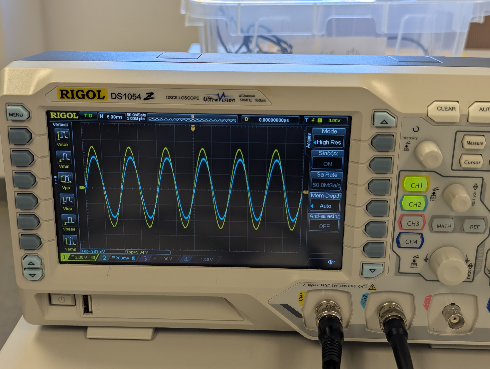
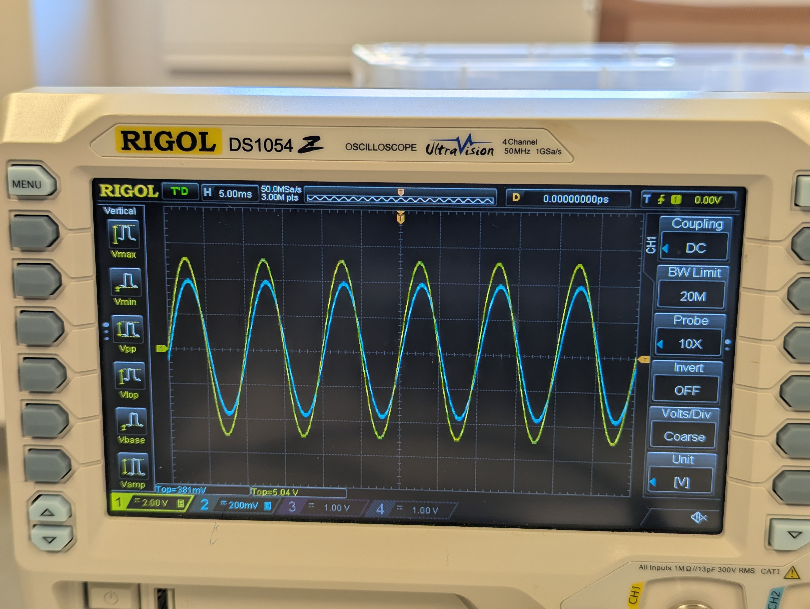

## 🔵 Oscilloscope Bonus Grade Policy
During this semester, there will be opportunities to earn bonus points in **Lab 2, 3, 4, 5, 7, 8**.

All bonus activities are related to benchtop oscilloscope (Scope) usage.

Each bonus lab is worth **5 points**. A max of 4 bonus labs will be counted, for up to **20 bonus points** toward your final course grade.

> [!NOTE]
> 
> You can go back to [← Lab 1 Scope Intro](../Lab%201%20Basic%20Lab%20Skills/Lab%201_Oscilloscope_Bonus.md) to recap basic operations.

## 🔵 Lab 7 - Two Channels Measurement 

### Task

Continue with today's circuit. 
- [ ] Use the same input signal from the Analog Discovery. 
- [ ] Set 5V amplitude, 100Hz sine wave from the Wavegen W1 pin. 
- [ ] Use two probes to connect with $V_{in}$ and $V_{out}$ of today's circuit, respectively

**Recall how to connect probes:** [← Lab 3 Scope Bonus](../Lab%203%20Step%20Response/Lab%203_Oscilloscope_Bonus.md) to look at its physical connections.
 Probe hook at the voltage pin you want to measure; Probe clip to the ground.

- [ ] Acquire signals from 2 channels. Adjust to get two clear signals. Two signals can be in different Y-scale (voltage scale).
- [ ] Configure "Acquire" to Mode "High Res".
- [ ] Configure 2 Channels, "CH1" and "CH2" to be "BW Limit 20 M"
- [ ] Measure the "Vtop" for both two signals.

- [ ] Example:

   

      
    

---

### ✅ Bonus Check 

- [ ] The lab staff will first reset your scope before your check demo
- [ ] **Individually show to the lab staff the operations towards the expected results** Then obtain the check for bonus. 
- [ ] Also **reset the scope after:**  press the "Storage" button, then select the "Default" option.

