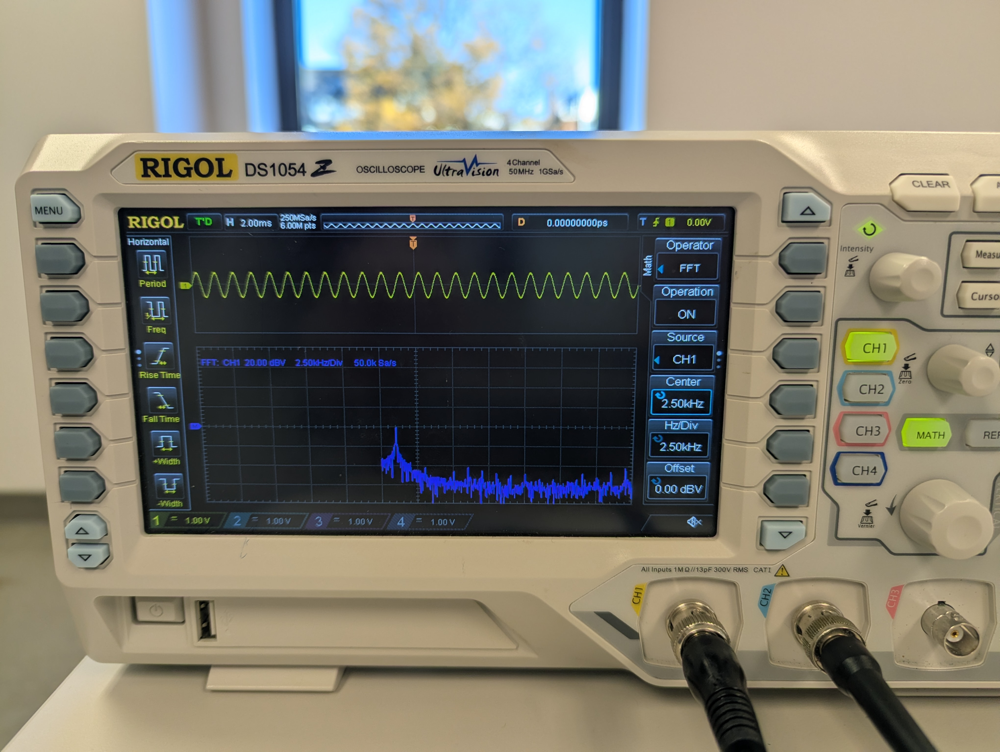
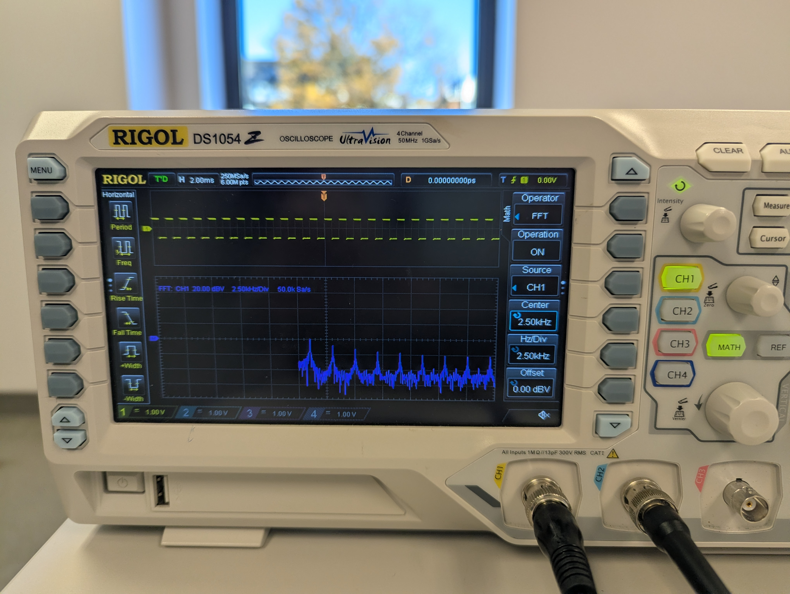

## 🔵 Oscilloscope Bonus Grade Policy
During this semester, there will be opportunities to earn bonus points in **Lab 2, 3, 4, 5, 7, 8**.

All bonus activities are related to benchtop oscilloscope (Scope) usage.

Each bonus lab is worth **5 points**. A max of 4 bonus labs will be counted, for up to **20 bonus points** toward your final course grade.

> [!NOTE]
> 
> You can go back to [← Lab 1 Scope Intro](../Lab%201%20Basic%20Lab%20Skills/Lab%201_Oscilloscope_Bonus.md) to recap basic operations.

## 🔵 Lab 8 - FFT (Fast Fourier Transform)

### Task

You can remove today's circuit.  
We will direct wire from Analog Discovery to the benchtop scope. 
The overall idea is to use benchtop scope FFT to directly inspect the a signal from the Analog Discovery.

**Connection:**

| Analog Discovery         | Benchtop Scope                     |
| -------------------- | ------------------------------------ |
| W1 pin | probe hook |
| Ground      | probe chip                       |

- [ ] In WaveForms Wavegen, set a sine signal as 1 kHz. 
- [ ] Use the benchtop scope to observe the signal.
- [ ] In "MATH", set to the "FFT" and turn the operation "ON".
- [ ] adjust some paramters until you see a clear single peak (as my example pic)

- [ ] Next, go to WaveForms Wavegen, change a signal from sine to square, same 1 kHz. 
- [ ] See how the FFT changes on the scope. You are expect see multiple peaks now. These are called "harmonics of a square wave" (https://en.wikipedia.org/wiki/Square_wave_(waveform)#Fourier_analysis)

**Extra Note on FFT:** For FFT analysis, the Analog Discovery with WaveForms software you used in regular lab is actually better than our benchtop oscilloscope. Why?
- FFT is computationally intensive (more details in https://en.wikipedia.org/wiki/Fast_Fourier_transform#Computational_issues). 
- Our relatively cheap benchtop scope (~$400) has limited processing power inside. 
- If use Analog Discovery and WaveForms, the FFT computation is done on your laptop processor. This allows for better FFT analysis and visualization.

---

### ✅ Bonus Check 

- [ ] The lab staff will first reset your scope before your check demo
- [ ] **Individually show to the lab staff the operations towards the expected results** Then obtain the check for bonus. 
- [ ] Also **reset the scope after:**  press the "Storage" button, then select the "Default" option.

